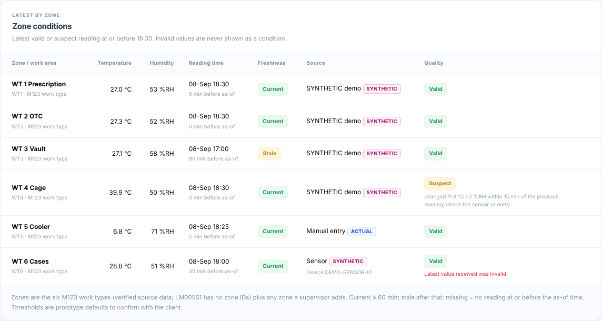
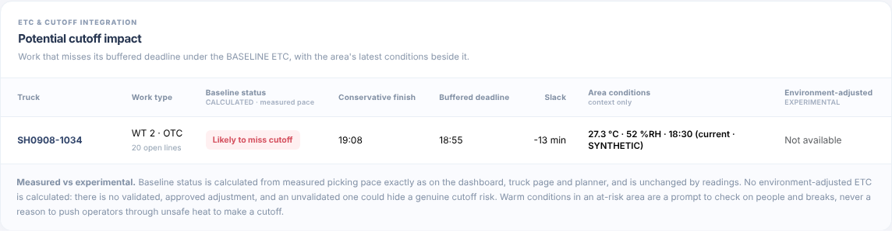
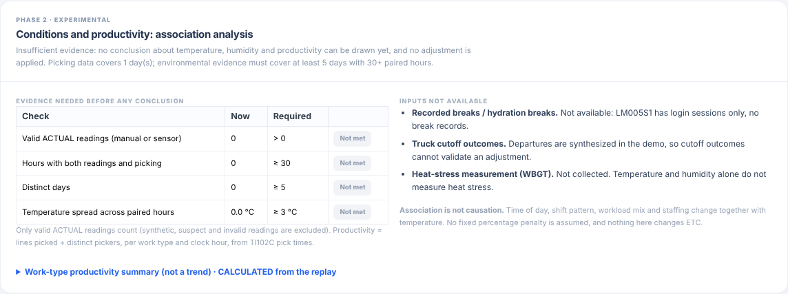

# v13 release — Environmental Conditions & Workforce Planning (implementation and testing notes)

**Date:** 2026-10-13 · **Baseline:** v12 (206 tests) · **Result:** 246 tests pass (206 existing, unchanged, + 40 new)
**Design (written before implementation):** [`ENVIRONMENT_DESIGN_v13.md`](ENVIRONMENT_DESIGN_v13.md) · **Hardware proposal and costs:** [`ENVIRONMENT_HARDWARE_PROPOSAL_v13.md`](ENVIRONMENT_HARDWARE_PROPOSAL_v13.md) · **Project status, client questions and gaps:** [`PROJECT_STATUS_v13.md`](PROJECT_STATUS_v13.md)

## 1. What was built

| Phase | Status in v13 |
|---|---|
| 1 Low-cost prototype | **Done.** Manual entry by zone; validation; freshness; dashboard card; Environment page. |
| 2 Productivity analysis | **Done, gated.** Association analysis that reports only when the evidence is sufficient. With today's data it correctly reports *insufficient evidence*. |
| 3 Sensor integration | **Software only.** Device registry, token-protected ingestion API, silent-sensor detection, tested with simulated API calls. **No hardware purchased, installed or tested. No firmware written.** |
| 4 Validated ETC adjustment | **Not implemented, by design.** Proposal in section 6. |

### Where it appears

- **Environment page** (sidebar → Environment, `/environment?snapshot=n`):
  - summary tiles;
  - zone conditions table;
  - missing, stale and sensor attention list;
  - potential cutoff impact (baseline vs "Environment-adjusted: not available");
  - temperature and humidity trend charts with a table view;
  - manual entry form and recent readings log;
  - experimental analysis;
  - sensors and zones (register device, add zone, API status);
  - hydration and heat-safety information with client-editable site notes;
  - synthetic demo controls.
- **Dashboard:** "Work-area conditions" card with latest °C / %RH, time and status by zone, an attention count, and "Environment-adjusted ETC: not available".
- **Truck detail:** an *Area conditions (context only)* column in the Work types table.
- **Workforce allocation:** an *Area conditions (context only)* column in At-risk pickups, with a note that conditions never change recommendations and that operators must not be asked to work through unsafe heat.

## 2. Data handling

- **Separate database.** `data/environment.db` (`ENV_DATABASE_URL`) holds `env_zone`, `env_device`, `env_reading` and `env_site_note`. Nothing is written to the workbook, the WMS/LMS source tables or the rebuildable `truck_etc.db` cache (tested by hash and table list). The file is created on first run and is git-ignored. The package ships without it.
- **Zones.** Seeded from the six M123 work types, the only verified work areas (`LM005S1.ZONEID` is empty and TI102 `SRCLOC` holds bin codes). Supervisors can add zones, labelled *user added*. No zone was invented.
- **Labels.**
  - Manual and sensor readings are **ACTUAL**: as entered or measured, not yet verified against a reference instrument.
  - Demo readings are **SYNTHETIC**: created only by the explicit "Load synthetic demo readings" button, shown with a pink label, never used as evidence, and deletable in one click.
  - Analysis output is **CALCULATED / EXPERIMENTAL**.
- **Time.**
  - Stored in UTC.
  - Shown and entered in `WAREHOUSE_TIMEZONE` (default America/New_York; to be confirmed). On Windows this needs the `tzdata` package, which is in requirements.txt. If the time-zone data is missing, the page says so and shows UTC.
  - API times must include an offset or `Z`.
  - Conditions are evaluated at the selected snapshot ("as of"). A reading taken later than that time is never used.
- **Validation.**

  | Case | Behaviour |
  |---|---|
  | Manual: outside −40…85 °C or 0…100 %RH, non-numeric, NaN, unknown zone, > 5 min in the future | Rejected with a message |
  | Sensor: out-of-range or non-numeric value | Stored as **invalid**; never shown as a condition; zone and device flagged |
  | Change > 10 °C or > 30 %RH within 30 min of the previous reading | Stored as **suspect**; shown with a warning; excluded from analysis |
  | Same zone, time, method and device | Stored once; reported as a duplicate (safe sensor retries) |
  | Latest valid reading ≤ 60 min old / older / none | **current** / **stale** / **missing** |
  | Registered device silent > 30 min, latest value invalid, or never reported | **Sensor requires attention** |

  All thresholds are in `.env`. They are prototype defaults, not agreed business rules.
- **Access.** Every form needs the session form token. An optional shared `ENV_ENTRY_KEY` restricts entry to authorized users. The sensor API is off unless `ENV_INGEST_TOKEN` is set, and then requires `Authorization: Bearer <token>`. Real user sign-in is still an open production gap (APP-001).

## 3. ETC, cutoff and allocation: unchanged

The feature only reads results. `build_state`, the ETC engine, the ready-time chart, the safety buffer, the planner search and the temporary-operator search take no environmental input. Environmental context is computed *after* the ETC figures, in a wrapper that never raises (`area_conditions`). If the environment database is unavailable:

- the dashboard, truck and planner pages still render with the baseline figures and say "Unavailable";
- the Environment page returns 503.

The "Potential cutoff impact" table lists work that misses its buffered deadline under the **baseline** ETC (measured pace), with the area's conditions beside it. The *Environment-adjusted* column always reads "Not available". An unvalidated adjustment could hide a genuine cutoff risk or create false confidence.

## 4. Analysis (Phase 2, experimental)

Pairs valid ACTUAL readings with *lines per active picker-hour* (TI102C pick times) for the same work area and clock hour. A Spearman correlation with a 95 % bootstrap interval and a slope is reported only when all four checks pass:

- some valid ACTUAL readings exist;
- at least 30 paired hours;
- at least 5 distinct days;
- a temperature spread of at least 3 °C.

The result is always labelled "association, not causation". Breaks, hydration breaks and WBGT are listed as **not available**: LM005S1 has login sessions only, and WBGT is not collected. Cutoff outcomes are synthesized in the demo, so they cannot validate anything.

**Today:**
- 0 ACTUAL readings, so the analysis reports "insufficient evidence".
- The replay covers 1 day, so the per-work-type productivity table is labelled a *summary, not a trend*.
- Tests show that with sufficient (fabricated in-test) data the analysis reports a negative association and its interval. With 4 days, or a 1 °C spread, it withholds results.

## 5. Synthetic demonstration set

"Load synthetic demo readings" writes readings for the replay day, 16:00–20:30 every 15 minutes, using a generic pattern (24 °C + 3 sin, 55 %RH + 8 cos). These are **not SMD conditions**. The set is designed to show every status at 18:30:

| Zone | Status at 18:30 |
|---|---|
| WT 1, WT 2 | Current |
| WT 3 | Stale (last reading 17:00) |
| WT 4 | Suspect (+12 °C jump at 18:30) |
| WT 5 | Missing |
| WT 6 | Sends one invalid 999 °C value at 18:05 through `DEMO-SENSOR-01` (a SYNTHETIC device record, not hardware), then stops reporting |

Loading twice stores nothing new. "Delete all synthetic readings" removes them and the demo device, and keeps ACTUAL readings.

## 6. Phase 4 proposal (not implemented; needs evidence and approval)

1. **Evidence.** At least 4–8 weeks of ACTUAL readings in the confirmed zones, with a reference-checked sensor or regular manual entry, covering a real temperature range. Use real departures and cutoffs, not the synthesized replay. Ideally include recorded breaks.
2. **Model.** Fit pace ~ temperature (and humidity) with controls for hour, work type, operator mix and workload. Validate on held-out weeks. Report the effect with an interval.
3. **Approval.** SMD operations and HSE agree an adjustment only if the interval excludes zero and the backtest improves ETC error.
4. **Implementation.** Off by default (`ENV_ADJUSTMENT_ENABLED=false`), with the coefficient in `.env`. The baseline ETC always stays visible beside the adjusted one. The adjustment may only make the ETC **slower**, never faster: an environmental factor must never hide a genuine cutoff risk.
5. **Allocations.** Recalculate ready time, status and operator requirements on the adjusted value only after explicit approval. Keep a reversible switch and an audit line on every page that uses it.

## 7. Tests (`tests/test_environment_v13.py`, 40 tests)

- **Normal operation.** Manual and API readings stored valid and current; local/UTC conversion (EDT); display text.
- **Missing and stale.** Missing and stale zones; a reading after the snapshot is not used.
- **Invalid input.** Seven invalid manual inputs rejected; unknown zone and future time rejected; duplicates stored once.
- **Suspect and invalid readings.** Suspect step flagged and excluded; a step over 30 min is valid; sensor out-of-range and null values stored invalid and never displayed.
- **Sensor API.** Disabled (503); wrong or missing token (401); non-JSON (400); more than 500 items (413); unregistered device, missing offset and non-object items rejected per item.
- **Sensor disconnection.** Silent 40 min → attention while the zone is still current; never-reported device flagged.
- **Synthetic data.** Covers every status, is idempotent, is never evidence, deletes cleanly and leaves ACTUAL readings.
- **Analysis gating.** Results reported only with sufficient evidence; "NOT evidence of cause"; results withheld for 4 days or a 1 °C spread.
- **Unchanged calculations.** ETC, status, ready times, rates, minimum-operator recommendation and preview are identical at snapshots 6, 10 and 11 with no readings vs synthetic + hot/humid + invalid readings. At-risk API, CSV export and ready-chart data are identical before and after readings. With the environment database broken, the dashboard, truck and planner still render with identical CSV. Workbook hash and cache tables are unchanged.
- **Web.** Empty page states "context only", hides empty charts and shows "Not available". Synthetic page shows statuses, colour-per-zone trend data, the dashboard card and the truck column. Manual form stores local time and reports errors and duplicates. Form token required. Entry key enforced. Device, zone and note forms work. Zones API reports `used_in_etc: false`.

**Full suite:** 246 passed (`python -m pytest -q`, about 100 s). **Browser check:** Chromium at 1440 px and 390 px. No horizontal overflow on mobile and no page script errors. The only console errors were blocked external font and icon CDNs in the test sandbox.

## 8. Files

- **Added:**
  - `models/environment.py`, `calculations/environment.py`, `calculations/environment_analysis.py`
  - `templates/environment.html`, `static/js/environment.js`
  - `tests/test_environment_v13.py`
  - `ENVIRONMENT_DESIGN_v13.md`, this file, `ENVIRONMENT_HARDWARE_PROPOSAL_v13.md`, `PROJECT_STATUS_v13.md`
  - `docs/images/v13-*.png`
- **Modified:**
  - `app.py`: Environment routes and API; context helpers; dashboard, truck and planner context only.
  - `config.py`, `.env`: `ENV_*` settings.
  - `requirements.txt`: `tzdata` on Windows.
  - `.gitignore`: `data/environment.db`.
  - Templates: `templates/base.html` (sidebar link), `templates/dashboard.html`, `templates/truck_detail.html`, `templates/planner.html`.
  - `static/css/style.css`.
  - `tests/conftest.py`: separate test environment database; `clean_env` fixture.
  - README, guide notice and tracking docs.
- **Unchanged:** workbook, `truck_etc.db` contents, the ETC engine, pace, deadlines, reallocation and temporary-operator logic.
